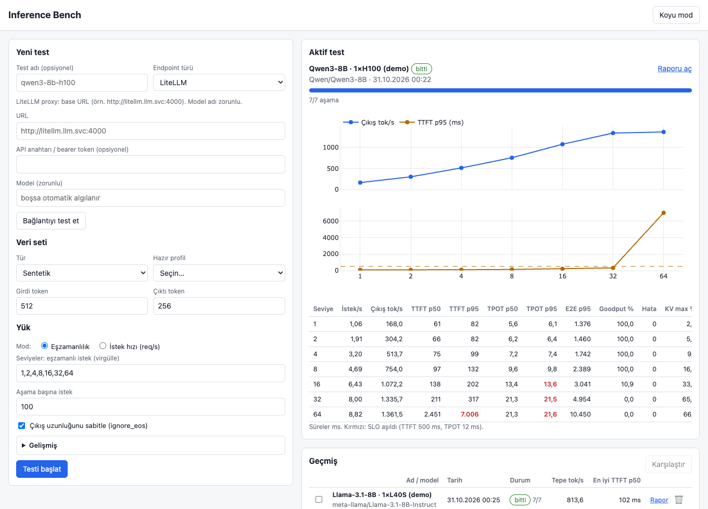
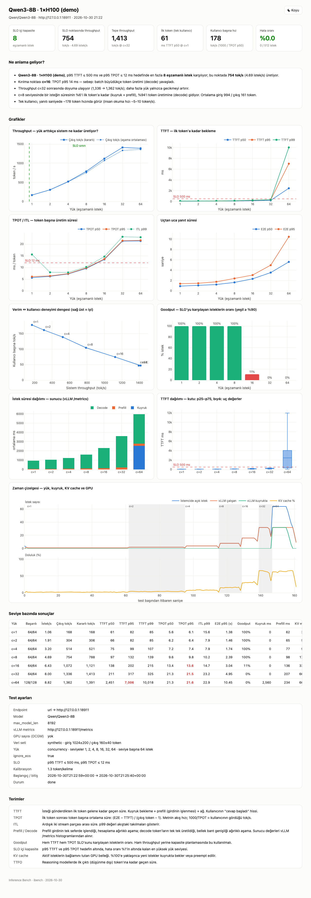
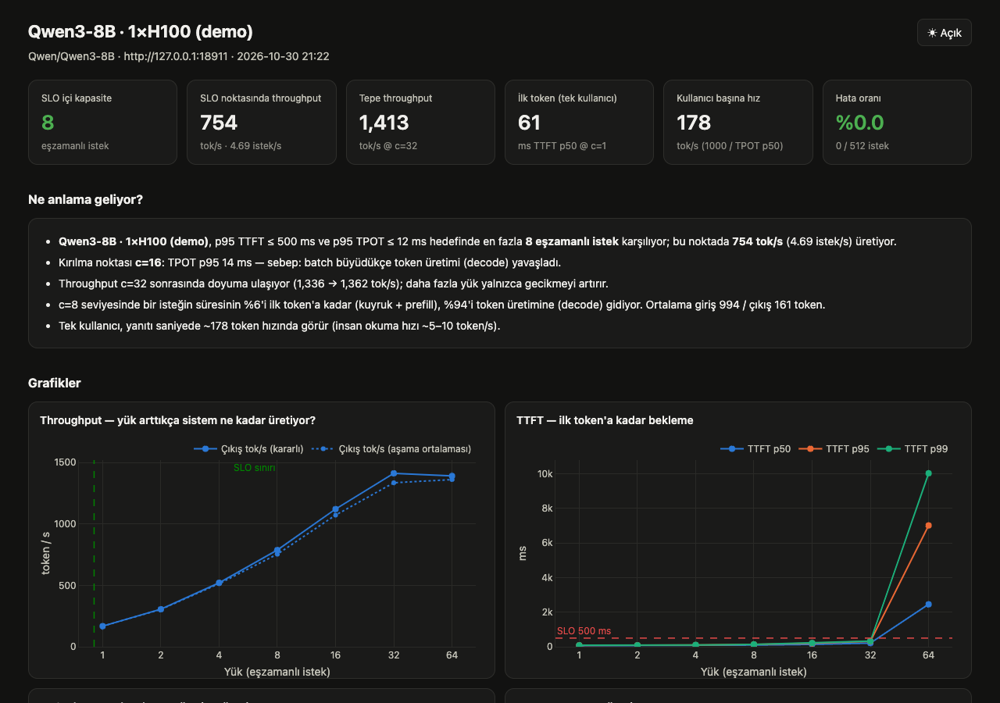
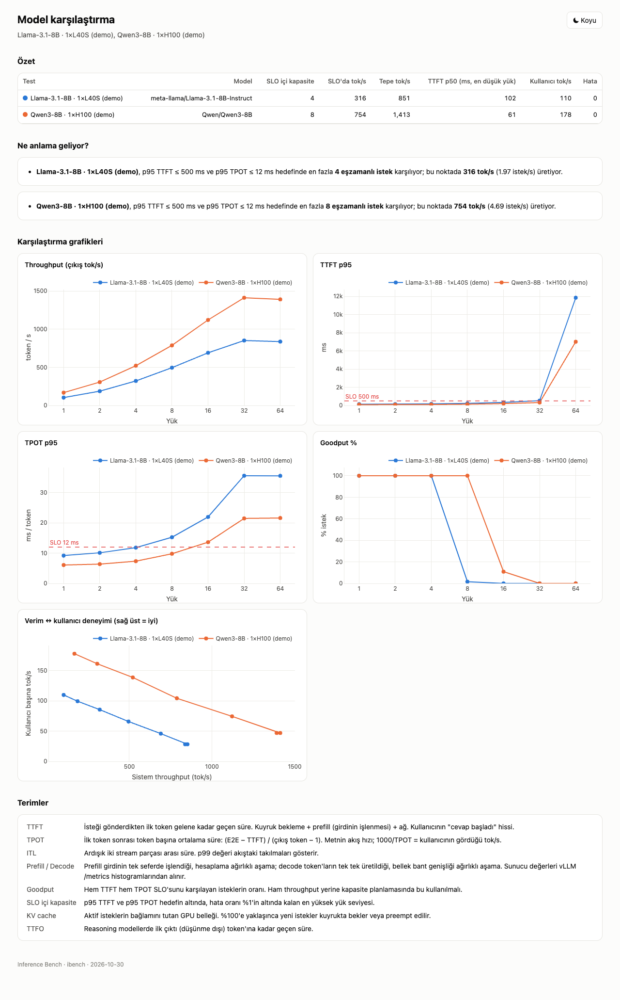

# Inference Bench

A benchmark tool that measures LLM inference endpoints (vLLM and any OpenAI-compatible server) before they go to production.

[Türkçe](README.md) · **English**





*Screenshots show demo data generated with `ibench mock`, not a real model measurement.*

## What it does

- Puts controlled load on an endpoint (concurrency sweep or request-rate sweep) and measures TTFT, TPOT, ITL, E2E, throughput and goodput at every load level.
- Puts server and GPU metrics from vLLM `/metrics` and the DCGM exporter on the same timeline. So it tells you not only where the endpoint breaks but why (KV cache full, server queue, decode slowdown, preemptions).
- Produces a single self-contained HTML report that works air-gapped. It states in plain language the highest load level that stays within your SLO (the recommended capacity).
- One static Go binary: `ibench`. Standard library only, no Python. The web UI and a ShareGPT subset are embedded in the binary.
- Runs on OpenShift behind OpenShift OAuth, and resolves Service, Route and Pod names itself through the Kubernetes API.

Only one benchmark runs at a time. Parallel runs would distort each other's measurements, so this is deliberate.

## Contents

- [Quick start (local)](#quick-start-local)
- [CLI](#cli)
- [Endpoint types](#endpoint-types)
- [Load and prompt settings](#load-and-prompt-settings)
- [Metrics and how they are measured](#metrics-and-how-they-are-measured)
- [Report](#report)
- [Config example](#config-example)
- [OpenShift deployment](#openshift-deployment)
- [Why Go?](#why-go)
- [Comparison with existing tools](#comparison-with-existing-tools)
- [Screenshots](#screenshots)
- [Glossary](#glossary)
- [Project layout](#project-layout)

## Quick start (local)

```bash
go build -o ibench .
./ibench mock -addr :8001 &
./ibench serve         # http://localhost:8080 → URL: http://localhost:8001
go test ./...          # end-to-end check against the built-in mock
```

After `ibench serve` starts, open `http://localhost:8080`, pick the `url` endpoint type, enter `http://localhost:8001`, click "Test connection" (the button label in the UI is Turkish: "Bağlantıyı test et") and start. No GPU needed.

## CLI

| Command | Description |
|---|---|
| `ibench serve [-addr :8080] [-data ./ibench-data]` | Web UI + API. The `DATA_DIR` environment variable also works. Runs are stored as JSON under the data dir (a PVC on OpenShift). |
| `ibench run -f config.json [-o run.json] [-html report.html]` | Headless run (CI or an OpenShift Job). Prints a per-level summary table. |
| `ibench report run1.json [run2.json ...] > report.html` | One report, or a comparison report when you pass several files. |
| `ibench mock [-addr :8000] [-model mock-model] [-speed 1]` | Fake vLLM server: streaming, batching slowdown, KV cache, `/metrics`. For trying the tool without a GPU. |
| `ibench version` | Version. |

## Endpoint types

The UI form and `endpoint.type` in the config use the same types.

| type | fields | resolves to |
|---|---|---|
| `litellm` | url, model (required), api_key | LiteLLM proxy base URL. Server metrics only if `metrics_url` is given. |
| `service` | name, namespace, port, scheme | `http(s)://name.namespace.svc.cluster.local:port` |
| `route` | name, namespace | Host read from the Route through the Kubernetes API (https if TLS). |
| `pod` | name, namespace, port, scheme (or raw IP url) | Pod IP read through the Kubernetes API. |
| `url` | url | Any OpenAI-compatible base URL. |

- `api_key` is sent as a Bearer token (a LiteLLM key or an OpenShift AI token). It is never written to disk.
- `verify_tls` can be turned off for self-signed Routes.
- The "Test connection" button lists the models, `max_model_len`, and whether `/metrics` is reachable.

## Load and prompt settings

**Load**

- Concurrency sweep (closed loop): for example `1,2,4,…,64`.
- Request-rate sweep: Poisson or gamma arrivals (via `burstiness`), with an optional `max_concurrency` cap.
- Warmup requests are sent first. Before every stage the client pre-opens one connection per concurrent request, so TCP/TLS setup does not pollute TTFT.
- Per-request timeout is configurable.

**Prompt source**

- Synthetic: target input/output tokens ± std. An optional shared system-prompt prefix tests prefix caching. Lengths are calibrated against the server's `usage` token counts, so no tokenizer download is needed.
- ShareGPT: a 3000-conversation subset embedded in the binary (the dataset vLLM bench uses).
- Custom JSONL upload: one `{"prompt": "...", "max_tokens": 256}` or `{"messages": [...]}` per line.

`ignore_eos` + `min_tokens` fix the output length. If the endpoint rejects them, they are disabled automatically with a warning.

## Metrics and how they are measured

**Client side (per level)**

- TTFT, TTFO (first non-reasoning token, for reasoning models), TPOT, ITL (pooled per-chunk gaps), E2E: mean / p50 / p90 / p95 / p99.
- Output, input and total tok/s; steady-state output tok/s (only the window when load is at the full level, excluding ramp-up and tail); requests/s.
- Goodput: the percentage of requests that meet both the TTFT and the TPOT SLO.
- Client-side queue time in rate mode (a coordinated-omission warning).

**Server side (vLLM `/metrics`)**

Scraped every second, plus exact counter deltas at stage boundaries: queue / prefill / decode time, KV cache usage, running/waiting requests, prefix cache hit rate, preemptions.

**GPU (DCGM exporter, via OpenShift monitoring)**

Queried from thanos-querier with a ServiceAccount token: utilization, memory, power, tokens per joule, tokens/s per GPU.

**Timing**

- Monotonic clock.
- TTFT = request sent → first non-empty content/reasoning chunk. Role-only and usage chunks are ignored.
- E2E ends at the last content chunk.
- Token counts come from the server's `usage` field.

## Report

A single HTML file; plotly is embedded, so it opens air-gapped. It has a light/dark toggle. Up to 8 runs can be compared side by side.

- KPI tiles: highest load level within SLO (recommended capacity), throughput at that point, peak throughput, single-user TTFT, per-user tok/s, error rate, GPU.
- A plain-language "what does it mean" section: the breaking point and its cause (KV cache full, server queue, decode slowdown, preemptions).
- Charts: throughput, TTFT, TPOT/ITL, E2E, throughput vs per-user speed trade-off, goodput, queue/prefill/decode breakdown, TTFT box plot, timeline of load + KV cache + GPU.
- Per-level table, config and glossary.

## Config example

For `ibench run -f config.json`. Only the important fields are shown; the rest take defaults (synthetic 512/256 tokens, levels 1..64, 100 requests per level, SLO 2000 ms TTFT / 100 ms TPOT).

```json
{
  "name": "llama-3-8b-trial",
  "endpoint": {
    "type": "service",
    "name": "llama-predictor",
    "namespace": "my-models",
    "port": 80,
    "scheme": "http",
    "api_key": "",
    "verify_tls": true,
    "metrics_url": ""
  },
  "model": "llama-3-8b",
  "dataset": {
    "type": "synthetic",
    "input_tokens": 512,
    "input_std": 64,
    "output_tokens": 256,
    "output_std": 32,
    "shared_prefix_tokens": 0
  },
  "load": {
    "mode": "concurrency",
    "levels": [1, 2, 4, 8, 16, 32, 64],
    "requests_per_stage": 100,
    "warmup": 5,
    "timeout_s": 300
  },
  "ignore_eos": true,
  "slo": { "ttft_ms": 2000, "tpot_ms": 100 },
  "prometheus": {
    "enabled": true,
    "gpu_selector": "exported_namespace=\"my-models\""
  }
}
```

Note: the valid values of `dataset.type` and `load.mode` (synthetic / ShareGPT / custom; concurrency / request rate) match the options in the UI. In request-rate mode, `levels` are req/s values; `max_concurrency` and `burstiness` apply only in this mode.

## OpenShift deployment

The tool runs on OpenShift behind OAuth as a single replica. The steps below go from nothing to a working install.

### Files in the repo

| File | Content |
|---|---|
| `openshift/kustomization.yaml` | namespace `inference-bench`, collects the resources below |
| `serviceaccount.yaml` | ServiceAccount with the OAuth redirect annotation |
| `rbac.yaml` | `inference-bench-resolver` ClusterRole (get/list on pods, services, routes) + ClusterRoleBinding; binding to `cluster-monitoring-view`; `system:auth-delegator` for oauth-proxy |
| `pvc.yaml` | 2Gi, RWO. Run history lives here |
| `build.yaml` | ImageStream + BuildConfig (Binary source, Docker strategy) |
| `deployment.yaml` | `ibench serve` (8080) + oauth-proxy sidecar (8443); `Recreate`, 1 replica |
| `service.yaml` | 8443, serving cert from service-ca |
| `route.yaml` | reencrypt |
| `networkpolicy.yaml` | Only 8443 is reachable; the unauthenticated 8080 stays pod-local |
| `demo-mock.yaml` | Optional: Deployment + Service `ibench-mock` (port 8000) running `ibench mock`, same image |

The `Dockerfile` is multi-stage: build on ubi9 go-toolset, run on ubi9 ubi-micro. The image is about 40 MB and runs as a non-root arbitrary UID. `ENTRYPOINT ibench`, `CMD serve`.

### 0. Prerequisites

- The `oc` CLI, logged in (`oc login`).
- Cluster-admin once, for the ClusterRole and ClusterRoleBindings. An admin can do this for you; if you do not want to use cluster-admin, see [least privilege](#least-privilege) below.
- Clone this repo and enter it:

```bash
git clone <this-repo-url> inference-bench && cd inference-bench
```

### 1. Create the project

```bash
oc new-project inference-bench
```

### 2. Create the cookie secret

oauth-proxy needs this secret to sign the session cookie. The deployment expects the name `inference-bench-cookie` (key: `session_secret`). Do not commit it to the repo.

```bash
oc create secret generic inference-bench-cookie \
  --from-literal=session_secret="$(openssl rand -base64 24 | tr -d '\n')"
```

### 3. Apply the resources

```bash
oc apply -k openshift/
```

### 4. Build the image

Binary build: your local source is uploaded to OpenShift and built inside the cluster. Apart from the base images from `registry.access.redhat.com`, no internet access is needed.

```bash
oc start-build inference-bench --from-dir=. --follow
oc rollout status deploy/inference-bench
```

The deployment rolls out by itself when the build finishes, through the ImageStream trigger.

### 5. Open the UI

```bash
oc get route inference-bench -o jsonpath='{.spec.host}'
```

Open `https://<host>` and log in with your OpenShift account. To get in you need `get pods` in the `inference-bench` namespace (project admin, edit or view is enough).

### 6. Try it without a GPU

```bash
oc apply -n inference-bench -f openshift/demo-mock.yaml
```

In the UI choose endpoint type `Service`, name `ibench-mock`, namespace `inference-bench`, port `8000`, scheme `http`. Click "Test connection", then start.

### 7. A real model

- **OpenShift AI / KServe vLLM ServingRuntime:** the Service is usually named `<isvc-name>-predictor`. For RawDeployment the port is 80; check with `oc get svc -n <ns>`. Alternatively use the Route type and enter the Route name.
- **Token-protected endpoint:** put the token into the "API key" field. `oc create token <sa> -n <ns>` or the model's token secret both work.
- **LiteLLM:** type `litellm`; enter url, model name and key. Server metrics do not come through LiteLLM; to get them, set "metrics URL" to `http://<vllm-svc>.<ns>.svc.cluster.local:<port>/metrics`.

### 8. GPU telemetry

- The NVIDIA GPU Operator must be installed and the DCGM exporter must be scraped by cluster monitoring (the GPU operator namespace needs the label `openshift.io/cluster-monitoring=true`).
- Check: in the console, go to Observe → Metrics and query `DCGM_FI_DEV_GPU_UTIL`.
- In the UI, fill the "GPU selector" field, for example `exported_namespace="my-models"` or `Hostname="gpu-node-1"`.
- DCGM is scraped every 15-30 s. Make each level last at least 60 s, otherwise the GPU chart will be empty or noisy.
- The app queries `thanos-querier.openshift-monitoring.svc:9091` with the ServiceAccount token; the `cluster-monitoring-view` binding is in `rbac.yaml`.

### 9. Headless run as a Job (optional)

You can run `ibench run` from the same image. Put the config in a ConfigMap, mount it in a Job, and write the output to the PVC:

```bash
oc create configmap ibench-config --from-file=config.json
```

```yaml
apiVersion: batch/v1
kind: Job
metadata:
  name: ibench-run
spec:
  template:
    spec:
      restartPolicy: Never
      serviceAccountName: inference-bench
      containers:
        - name: ibench
          image: image-registry.openshift-image-registry.svc:5000/inference-bench/inference-bench:latest
          args: ["run", "-f", "/cfg/config.json", "-o", "/data/run.json", "-html", "/data/report.html"]
          volumeMounts:
            - {name: cfg, mountPath: /cfg}
            - {name: data, mountPath: /data}
      volumes:
        - name: cfg
          configMap: {name: ibench-config}
        - name: data
          persistentVolumeClaim: {claimName: inference-bench-data}   # RWO: may hang if the serve pod is on another node; use a separate PVC if needed
```

For Service/Route/Pod name resolution the ServiceAccount needs the `inference-bench-resolver` permissions; the `serviceAccountName` above provides them.

### Least privilege

Delete the cluster-wide resolver binding and create RoleBindings only in the model namespaces:

```bash
oc delete clusterrolebinding inference-bench-resolver   # the name must match the one in rbac.yaml
oc create rolebinding inference-bench-resolver -n <model-ns> \
  --clusterrole=inference-bench-resolver \
  --serviceaccount=inference-bench:inference-bench
```

### NetworkPolicy (model namespace)

OpenShift AI model namespaces often have NetworkPolicies. Allow ingress from the `inference-bench` namespace to the model pods:

```yaml
apiVersion: networking.k8s.io/v1
kind: NetworkPolicy
metadata:
  name: allow-inference-bench
  namespace: <model-ns>
spec:
  podSelector: {}
  policyTypes: [Ingress]
  ingress:
    - from:
        - namespaceSelector:
            matchLabels:
              kubernetes.io/metadata.name: inference-bench
```

### crc / OKD and air-gapped notes

- **crc / OKD:** the `registry.redhat.io` image needs a pull secret. For a local setup, change the oauth-proxy image in `deployment.yaml` to `quay.io/openshift/origin-oauth-proxy:4.16`.
- **Air-gapped:** mirror the two base images (ubi9 go-toolset, ubi9 ubi-micro) and the oauth-proxy image into your internal registry. Nothing else is downloaded; ShareGPT is already in the binary.
- Deployment is `Recreate` with one replica: the PVC is RWO, and only one benchmark should run at a time.

### Troubleshooting

| Symptom | Cause / fix |
|---|---|
| "No permission (403)" | Make sure the ServiceAccount is bound to the resolver ClusterRole (ClusterRoleBinding, or a RoleBinding in the target namespace). The logged-in user also needs `get pods` in the `inference-bench` namespace. |
| "/metrics could not be read" | You are behind LiteLLM, or metrics are on another port. Put the vLLM `/metrics` address in the "metrics URL" field. |
| x509 / TLS error | Self-signed Route: turn off `verify_tls`, or use the Service URL instead of the Route. |
| "GPU telemetry off" | Check the DCGM selector and the monitoring integration (step 8). `DCGM_FI_DEV_GPU_UTIL` must show up in Observe → Metrics. |
| "connection refused" / timeout from the pod | NetworkPolicy in the model namespace; apply the example above. |
| OAuth loop (keeps returning to login) | Wrong cookie secret name/key (`inference-bench-cookie` / `session_secret`) or the OAuth redirect annotation on the ServiceAccount. |
| Test stuck at high concurrency | Raise `timeout_s` and check the server's `max_num_seqs`: requests may be waiting in the server queue. |

## Why Go?

Measured against a mock server with known truth (TTFT 200 ms, ITL 20 ms). The earlier single-process Python asyncio client added +35 ms to TTFT p99 at concurrency 64 and +145 ms at 256. Its ITL became meaningless above ~1000 streams because it is capped at one CPU core. The Go client, using multiple cores, stayed within about ±5 ms up to 2048 concurrent streams.

| c | Python TTFT p99 | Go TTFT p99 (warm) | Python ITL p99 | Go ITL p99 |
|---|---|---|---|---|
| 64 | 235 ms | 207 ms | 43.8 ms | 21.7 ms |
| 256 | 345 ms | 232 ms | 72.4 ms | 31.7 ms |
| 2048 | 1716 ms | 202-205 ms | 236.6 ms | 20.8 ms |

Truth: TTFT 200 ms, ITL 20 ms.

## Comparison with existing tools

| | `vllm bench serve` | NVIDIA AIPerf | Inference Bench |
|---|---|---|---|
| Client | Python, single-process asyncio | Python, multi-process (ZeroMQ workers) | Go, goroutines, single binary |
| Tokenizer needed | yes (HF) | yes by default (HF) | no (server usage + calibration) |
| Server metrics | only spec-decode counters | yes (vLLM, SGLang, TRT-LLM, Dynamo) | vLLM `/metrics` |
| GPU telemetry | no | DCGM / pynvml | DCGM via OpenShift monitoring |
| UI / history | no | terminal dashboard + plot command | web UI, run history, comparison |
| Kubernetes | no | operator / CRDs | OpenShift-native: resolve Service/Route/Pod names, OAuth |
| Report | JSON (+ optional plots) | JSON/CSV + PNG plots | single HTML with plain-language interpretation |

What AIPerf has that we do not: trace replay, multi-turn conversations, multimodal input, and support for many server types. If you need those, AIPerf is the better fit. Inference Bench has a narrower goal: measure a vLLM or OpenAI-compatible endpoint on OpenShift correctly and present the result in a readable way.

## Screenshots

All are demo data from `ibench mock`.

**Web UI**


**Report (light)**


**Report (dark)**



**Model comparison**



## Glossary

| Term | Meaning |
|---|---|
| TTFT | Time To First Token. Time from sending the request to the first token. What the user waits for before the answer starts. |
| TTFO | Time To First Output token. For reasoning models, the time to the first real output token after the thinking part. |
| TPOT | Time Per Output Token. Average time per token after the first; the inverse of per-user streaming speed. |
| ITL | Inter-Token Latency. Time between consecutive chunks; shows stalls. |
| Prefill / decode | Prefill: the prompt is processed in one pass; it determines TTFT. Decode: tokens are generated one by one; it determines TPOT. |
| Goodput | Share of requests that meet both the TTFT and TPOT SLO. A more honest capacity measure than raw throughput. |
| KV cache | Memory the model keeps for earlier tokens. When it fills up, new requests wait or running ones are preempted. |

## Project layout

- `main.go`: CLI
- `engine.go`: load generation and measurement
- `server.go`: HTTP API
- `report.go`: HTML report
- `mock.go`: fake vLLM server
- `web/`: `index.html`, `report.html`, `plotly.min.js`
- `assets/sharegpt.jsonl`: embedded ShareGPT subset
- `openshift/`: OpenShift manifests
- `Dockerfile`: multi-stage image
- `tools/prepare_sharegpt.py`: helper script that prepares the ShareGPT subset
