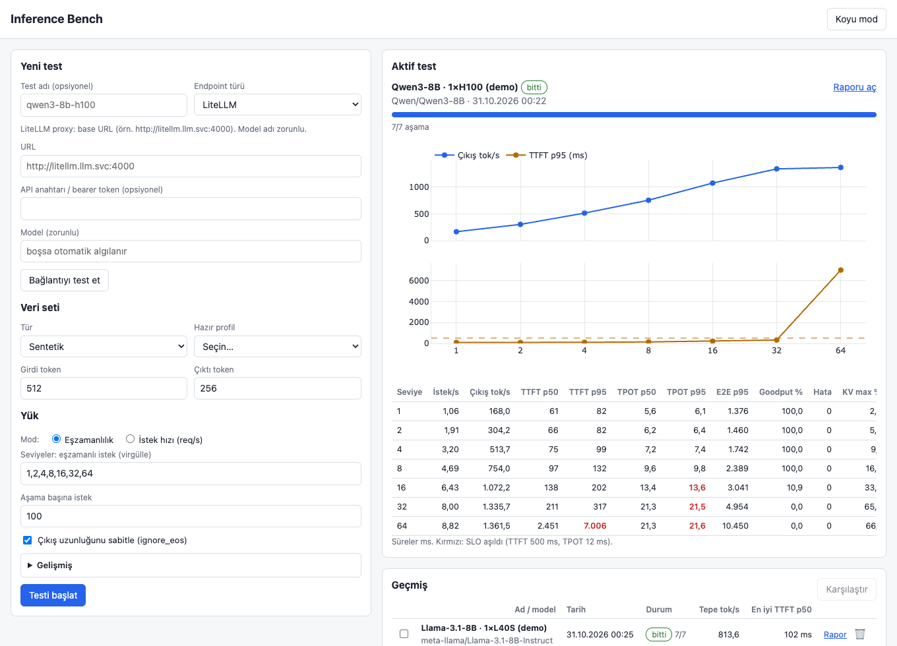
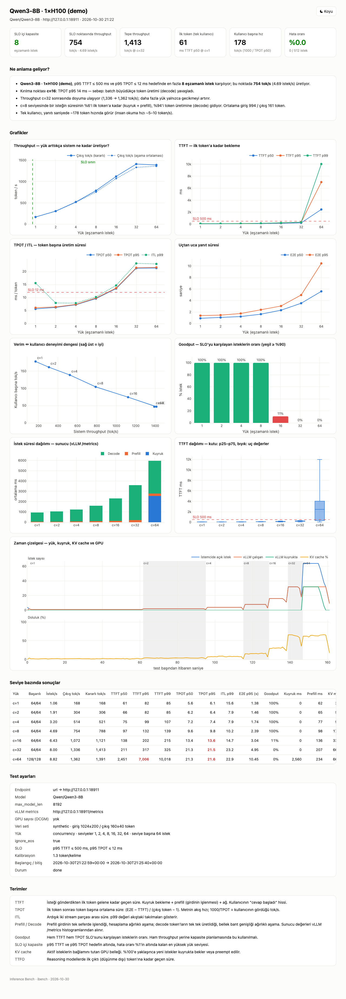
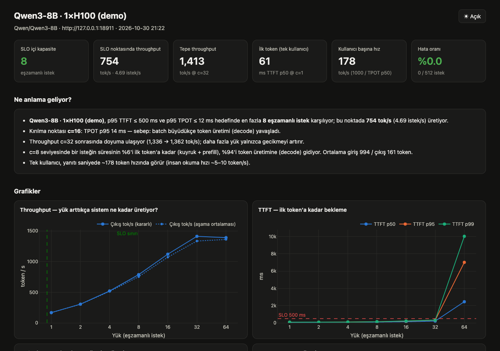
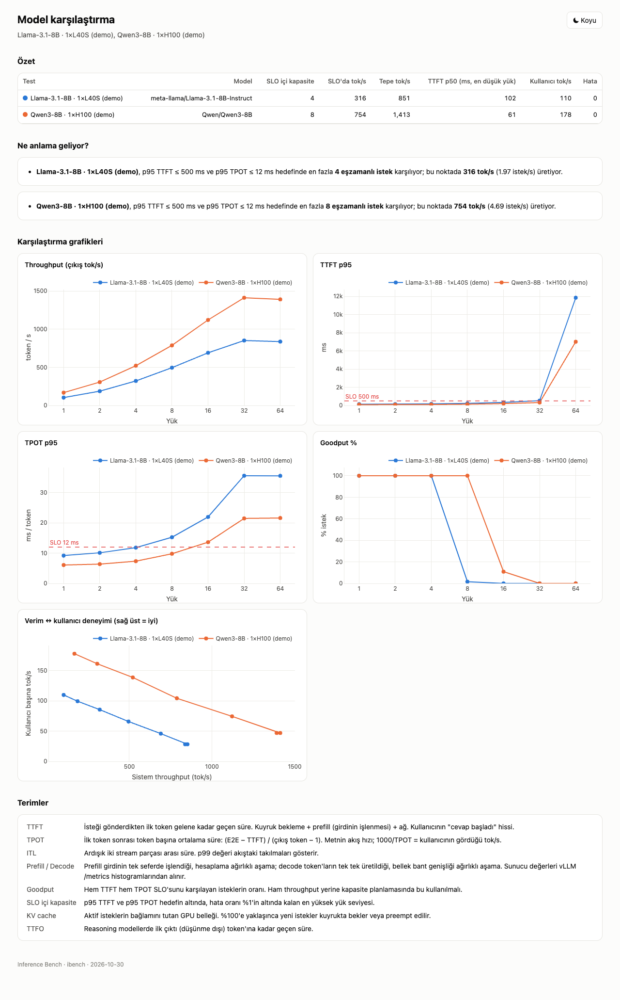

# Inference Bench

LLM inference endpoint'lerini (vLLM ve OpenAI uyumlu her sunucu) production'a çıkmadan önce ölçen benchmark aracı.

**Türkçe** · [English](README.en.md)





*Ekran görüntüleri `ibench mock` ile üretilen demo veridir, gerçek bir model ölçümü değildir.*

## Ne yapar?

- Bir endpoint'e kontrollü yük bindirir (eşzamanlılık veya istek hızı taraması) ve her yük seviyesinde TTFT, TPOT, ITL, E2E, throughput, goodput ölçer.
- vLLM `/metrics` ve DCGM exporter'dan sunucu ve GPU tarafını aynı zaman çizelgesine koyar. Böylece "nerede koptu" sorusunun yanında "neden koptu" cevabını da verir (KV cache doldu, sunucu kuyruğu, decode yavaşladı, preemption).
- Tek dosyalık, internet gerektirmeyen HTML rapor üretir. Rapor, SLO içinde taşınabilen en yüksek yük seviyesini (önerilen kapasite) düz bir dille anlatır.
- Tek statik Go binary'si: `ibench`. Sadece standart kütüphane, Python yok. Web arayüzü ve ShareGPT alt kümesi binary'nin içinde gömülü.
- OpenShift üzerinde OpenShift OAuth arkasında çalışır; Service, Route ve Pod adlarını Kubernetes API'den kendisi çözer.

Aynı anda tek benchmark çalışır. Paralel çalıştırmalar birbirinin ölçümünü bozacağı için bilerek böyle.

## İçindekiler

- [Hızlı başlangıç (lokal)](#hızlı-başlangıç-lokal)
- [CLI](#cli)
- [Endpoint tipleri](#endpoint-tipleri)
- [Yük ve prompt ayarları](#yük-ve-prompt-ayarları)
- [Metrikler ve ölçüm yöntemi](#metrikler-ve-ölçüm-yöntemi)
- [Rapor](#rapor)
- [Config örneği](#config-örneği)
- [OpenShift kurulumu](#openshift-kurulumu)
- [Neden Go?](#neden-go)
- [Mevcut araçlarla karşılaştırma](#mevcut-araçlarla-karşılaştırma)
- [Ekran görüntüleri](#ekran-görüntüleri)
- [Sözlük](#sözlük)
- [Proje yapısı](#proje-yapısı)

## Hızlı başlangıç (lokal)

```bash
go build -o ibench .
./ibench mock -addr :8001 &
./ibench serve         # http://localhost:8080 → URL: http://localhost:8001
go test ./...          # yerleşik mock'a karşı uçtan uca test
```

`ibench serve` açıldıktan sonra tarayıcıda `http://localhost:8080` adresine git, endpoint tipi olarak `url` seç, `http://localhost:8001` yaz, "Bağlantıyı test et" ile doğrula ve başlat. GPU gerekmez.

## CLI

| Komut | Açıklama |
|---|---|
| `ibench serve [-addr :8080] [-data ./ibench-data]` | Web arayüzü + API. `DATA_DIR` ortam değişkeni de çalışır. Çalıştırmalar data dizininde JSON olarak saklanır (OpenShift'te PVC). |
| `ibench run -f config.json [-o run.json] [-html report.html]` | Arayüzsüz çalıştırma (CI veya OpenShift Job). Seviye başına özet tablo basar. |
| `ibench report run1.json [run2.json ...] > report.html` | Tek rapor; birden fazla dosya verirsen karşılaştırma raporu. |
| `ibench mock [-addr :8000] [-model mock-model] [-speed 1]` | Sahte vLLM sunucusu: streaming, batching yavaşlaması, KV cache, `/metrics`. GPU olmadan aracı denemek için. |
| `ibench version` | Sürüm. |

## Endpoint tipleri

Arayüzdeki form ve config'teki `endpoint.type` aynı tipleri kullanır.

| type | alanlar | çözümlenen adres |
|---|---|---|
| `litellm` | url, model (zorunlu), api_key | LiteLLM proxy base URL'i. Sunucu metrikleri yalnızca `metrics_url` verilirse gelir. |
| `service` | name, namespace, port, scheme | `http(s)://name.namespace.svc.cluster.local:port` |
| `route` | name, namespace | Host, Kubernetes API'den Route'tan okunur (TLS varsa https). |
| `pod` | name, namespace, port, scheme (veya ham IP url) | Pod IP'si Kubernetes API'den okunur. |
| `url` | url | OpenAI uyumlu herhangi bir base URL. |

- `api_key` Bearer olarak gönderilir (LiteLLM key'i veya OpenShift AI token'ı). Diske yazılmaz.
- Self-signed Route'lar için `verify_tls` kapatılabilir.
- "Bağlantıyı test et" butonu modelleri, `max_model_len` değerini ve `/metrics`'in erişilebilir olup olmadığını gösterir.

## Yük ve prompt ayarları

**Yük**

- Eşzamanlılık taraması (closed loop): örneğin `1,2,4,…,64`.
- İstek hızı taraması: Poisson veya gamma varışlar (`burstiness` ile), isteğe bağlı `max_concurrency` üst sınırı.
- Warmup istekleri vardır. Her aşamadan önce istemci, eşzamanlı istek sayısı kadar bağlantıyı önceden açar; böylece TCP/TLS kurulumu TTFT'ye karışmaz.
- İstek başına timeout ayarlanabilir.

**Prompt kaynağı**

- Synthetic: hedef girdi/çıktı token sayısı ± std. İsteğe bağlı ortak system-prompt öneki ile prefix caching test edilir. Uzunluklar sunucunun `usage` token sayılarına göre kalibre edilir, tokenizer indirmek gerekmez.
- ShareGPT: 3000 konuşmalık alt küme binary'nin içinde (vLLM bench'in kullandığı dataset).
- Custom JSONL yükleme: satır başına `{"prompt": "...", "max_tokens": 256}` veya `{"messages": [...]}`.

`ignore_eos` + `min_tokens` çıktı uzunluğunu sabitler. Endpoint bunları reddederse uyarı verilip otomatik kapatılır.

## Metrikler ve ölçüm yöntemi

**İstemci tarafı (seviye başına)**

- TTFT, TTFO (reasoning modellerde ilk reasoning-dışı token), TPOT, ITL (chunk aralıklarının birleşik dağılımı), E2E: ortalama / p50 / p90 / p95 / p99.
- Output, input ve toplam tok/s; steady-state output tok/s (yalnızca yük tam seviyedeyken olan pencere, ramp-up ve kuyruk hariç); requests/s.
- Goodput: hem TTFT hem TPOT SLO'sunu karşılayan isteklerin yüzdesi.
- İstek hızı modunda istemci tarafı kuyruk süresi (coordinated omission uyarısı).

**Sunucu tarafı (vLLM `/metrics`)**

Her saniye scrape edilir, aşama sınırlarında counter farkları ayrıca tam olarak hesaplanır: queue / prefill / decode süresi, KV cache kullanımı, running/waiting istek sayısı, prefix cache hit oranı, preemption sayısı.

**GPU (DCGM exporter, OpenShift monitoring üzerinden)**

thanos-querier'a ServiceAccount token'ı ile gidilir: utilization, bellek, güç, token/joule, GPU başına tok/s.

**Zamanlama**

- Monotonic clock kullanılır.
- TTFT = isteğin gönderilmesi → ilk boş olmayan content/reasoning chunk'ı. Yalnızca role içeren ve usage chunk'ları sayılmaz.
- E2E son content chunk'ında biter.
- Token sayıları sunucunun `usage` alanından alınır.

## Rapor

Tek HTML dosyası; plotly gömülü olduğu için air-gapped ortamda da açılır. Açık/koyu tema düğmesi vardır. En fazla 8 çalıştırma yan yana karşılaştırılabilir.

- KPI kutuları: SLO içindeki en yüksek yük seviyesi (önerilen kapasite), o noktadaki throughput, tepe throughput, tek kullanıcı TTFT'si, kullanıcı başına tok/s, hata oranı, GPU.
- "Ne anlama geliyor" bölümü: kopma noktası ve nedeni (KV cache doldu, sunucu kuyruğu, decode yavaşlaması, preemption) düz dille.
- Grafikler: throughput, TTFT, TPOT/ITL, E2E, throughput - kullanıcı başına hız dengesi, goodput, queue/prefill/decode dağılımı, TTFT box plot, yük + KV cache + GPU zaman çizelgesi.
- Seviye tablosu, config ve sözlük.

## Config örneği

`ibench run -f config.json` için. Burada yalnızca önemli alanlar var; gerisi varsayılanla gelir (synthetic 512/256 token, seviyeler 1..64, seviye başına 100 istek, SLO 2000 ms TTFT / 100 ms TPOT).

```json
{
  "name": "llama-3-8b-deneme",
  "endpoint": {
    "type": "service",
    "name": "llama-predictor",
    "namespace": "my-models",
    "port": 80,
    "scheme": "http",
    "api_key": "",
    "verify_tls": true,
    "metrics_url": ""
  },
  "model": "llama-3-8b",
  "dataset": {
    "type": "synthetic",
    "input_tokens": 512,
    "input_std": 64,
    "output_tokens": 256,
    "output_std": 32,
    "shared_prefix_tokens": 0
  },
  "load": {
    "mode": "concurrency",
    "levels": [1, 2, 4, 8, 16, 32, 64],
    "requests_per_stage": 100,
    "warmup": 5,
    "timeout_s": 300
  },
  "ignore_eos": true,
  "slo": { "ttft_ms": 2000, "tpot_ms": 100 },
  "prometheus": {
    "enabled": true,
    "gpu_selector": "exported_namespace=\"my-models\""
  }
}
```

Not: `dataset.type` ve `load.mode` için geçerli değerler (synthetic / ShareGPT / custom; eşzamanlılık / istek hızı) arayüzdeki seçeneklerle aynıdır. İstek hızı modunda `levels` req/s değerleri olur; `max_concurrency` ve `burstiness` bu modda geçerlidir.

## OpenShift kurulumu

Araç OpenShift'te OAuth arkasında, tek replika olarak çalışır. Aşağıdaki adımlar sıfırdan kuruluma kadar gider.

### Repodaki dosyalar

| Dosya | İçerik |
|---|---|
| `openshift/kustomization.yaml` | namespace `inference-bench`, aşağıdaki kaynakları toplar |
| `serviceaccount.yaml` | OAuth redirect annotation'lı ServiceAccount |
| `rbac.yaml` | `inference-bench-resolver` ClusterRole (pods, services, routes için get/list) + ClusterRoleBinding; `cluster-monitoring-view` bağlantısı; oauth-proxy için `system:auth-delegator` |
| `pvc.yaml` | 2Gi, RWO. Run geçmişi burada durur |
| `build.yaml` | ImageStream + BuildConfig (Binary source, Docker strategy) |
| `deployment.yaml` | `ibench serve` (8080) + oauth-proxy sidecar (8443); `Recreate`, 1 replika |
| `service.yaml` | 8443, service-ca ile serving cert |
| `route.yaml` | reencrypt |
| `networkpolicy.yaml` | Sadece 8443 erişilebilir; kimlik doğrulaması olmayan 8080 pod'un içinde kalır |
| `demo-mock.yaml` | İsteğe bağlı: `ibench mock` çalıştıran Deployment + Service `ibench-mock` (port 8000), aynı imaj |

`Dockerfile` çok aşamalı: ubi9 go-toolset ile derleme, ubi9 ubi-micro ile çalışma. İmaj yaklaşık 40 MB, root olmayan rastgele UID ile çalışır. `ENTRYPOINT ibench`, `CMD serve`.

### 0. Ön koşullar

- `oc` CLI kurulu ve cluster'a giriş yapılmış (`oc login`).
- ClusterRole ve ClusterRoleBinding'ler için bir kereliğine cluster-admin gerekir. Admin'e yaptırabilirsin; cluster-admin vermek istemiyorsan aşağıdaki [en az yetki](#en-az-yetki) bölümüne bak.
- Bu repoyu clone'la ve dizine gir:

```bash
git clone <bu-repo-url> inference-bench && cd inference-bench
```

### 1. Proje oluştur

```bash
oc new-project inference-bench
```

### 2. Cookie secret'ı oluştur

oauth-proxy oturum cookie'sini imzalamak için bu secret'a ihtiyaç duyar. Deployment `inference-bench-cookie` adını bekler (anahtar: `session_secret`). Repoya commit etme.

```bash
oc create secret generic inference-bench-cookie \
  --from-literal=session_secret="$(openssl rand -base64 24 | tr -d '\n')"
```

### 3. Kaynakları uygula

```bash
oc apply -k openshift/
```

### 4. İmajı derle

Binary build: yerel kaynak OpenShift'e yüklenir ve cluster içinde derlenir. Base imajlar için `registry.access.redhat.com` dışında internet gerekmez.

```bash
oc start-build inference-bench --from-dir=. --follow
oc rollout status deploy/inference-bench
```

Deployment, ImageStream tetikleyicisi sayesinde build bitince kendiliğinden yeniden başlar.

### 5. Arayüze gir

```bash
oc get route inference-bench -o jsonpath='{.spec.host}'
```

`https://<host>` adresini aç ve OpenShift hesabınla giriş yap. Girebilmek için `inference-bench` namespace'inde `get pods` yetkin olmalı (project admin, edit veya view yeterli).

### 6. GPU olmadan dene

```bash
oc apply -n inference-bench -f openshift/demo-mock.yaml
```

Arayüzde endpoint tipi `Service`, name `ibench-mock`, namespace `inference-bench`, port `8000`, scheme `http` seç. "Bağlantıyı test et" de, sonra başlat.

### 7. Gerçek model

- **OpenShift AI / KServe vLLM ServingRuntime:** Service adı genelde `<isvc-adı>-predictor`. RawDeployment'ta port 80'dir; emin olmak için `oc get svc -n <ns>`. Alternatif olarak Route tipini kullanıp Route adını yaz.
- **Token korumalı endpoint:** token'ı "API key" alanına yapıştır. `oc create token <sa> -n <ns>` veya modelin token secret'ı işe yarar.
- **LiteLLM:** tip `litellm`; url, model adı ve key'i gir. LiteLLM üzerinden sunucu metrikleri gelmez; almak için "metrics URL" alanına `http://<vllm-svc>.<ns>.svc.cluster.local:<port>/metrics` yaz.

### 8. GPU telemetrisi

- NVIDIA GPU Operator kurulu olmalı ve DCGM exporter cluster monitoring tarafından scrape edilmeli (GPU operator namespace'i `openshift.io/cluster-monitoring=true` label'ına sahip olmalı).
- Kontrol: konsolda Observe → Metrics altında `DCGM_FI_DEV_GPU_UTIL` sorgula.
- Arayüzde "GPU seçici" alanına örneğin `exported_namespace="my-models"` veya `Hostname="gpu-node-1"` yaz.
- DCGM 15-30 saniyede bir scrape edilir. Her seviyeyi en az 60 saniye sürecek şekilde ayarla, yoksa GPU grafiği boş veya gürültülü çıkar.
- Uygulama `thanos-querier.openshift-monitoring.svc:9091`'e ServiceAccount token'ı ile gider; `cluster-monitoring-view` yetkisi `rbac.yaml`'da bağlıdır.

### 9. Arayüzsüz çalıştırma (Job, isteğe bağlı)

Aynı imajla `ibench run` çalıştırabilirsin. config'i ConfigMap'e koyup Job'a bağla; çıktıyı PVC'ye yaz:

```bash
oc create configmap ibench-config --from-file=config.json
```

```yaml
apiVersion: batch/v1
kind: Job
metadata:
  name: ibench-run
spec:
  template:
    spec:
      restartPolicy: Never
      serviceAccountName: inference-bench
      containers:
        - name: ibench
          image: image-registry.openshift-image-registry.svc:5000/inference-bench/inference-bench:latest
          args: ["run", "-f", "/cfg/config.json", "-o", "/data/run.json", "-html", "/data/report.html"]
          volumeMounts:
            - {name: cfg, mountPath: /cfg}
            - {name: data, mountPath: /data}
      volumes:
        - name: cfg
          configMap: {name: ibench-config}
        - name: data
          persistentVolumeClaim: {claimName: inference-bench-data}   # RWO: serve pod başka node'daysa takılabilir, gerekirse ayrı PVC kullan
```

Service/Route/Pod adı çözümlemesi için ServiceAccount'un `inference-bench-resolver` yetkisi olması gerekir; yukarıdaki `serviceAccountName` bunu sağlar.

### En az yetki

Cluster genelindeki resolver bağlantısını silip, yalnızca model namespace'lerinde RoleBinding oluştur:

```bash
oc delete clusterrolebinding inference-bench-resolver   # adı rbac.yaml'daki ile aynı olmalı
oc create rolebinding inference-bench-resolver -n <model-ns> \
  --clusterrole=inference-bench-resolver \
  --serviceaccount=inference-bench:inference-bench
```

### NetworkPolicy (model namespace'i)

OpenShift AI model namespace'lerinde çoğunlukla NetworkPolicy vardır. `inference-bench` namespace'inden model pod'larına girişe izin ver:

```yaml
apiVersion: networking.k8s.io/v1
kind: NetworkPolicy
metadata:
  name: allow-inference-bench
  namespace: <model-ns>
spec:
  podSelector: {}
  policyTypes: [Ingress]
  ingress:
    - from:
        - namespaceSelector:
            matchLabels:
              kubernetes.io/metadata.name: inference-bench
```

### crc / OKD ve air-gapped notlar

- **crc / OKD:** `registry.redhat.io` imajı için pull secret gerekir. Lokal ortamda `deployment.yaml` içinde oauth-proxy imajını `quay.io/openshift/origin-oauth-proxy:4.16` yap.
- **Air-gapped:** iki base imajı (ubi9 go-toolset, ubi9 ubi-micro) ve oauth-proxy imajını iç registry'ye mirror'la. Başka bir şey indirilmez; ShareGPT zaten binary'nin içinde.
- Deployment `Recreate` + tek replika: PVC RWO olduğu için ve aynı anda tek benchmark çalışsın diye.

### Sorun giderme

| Belirti | Neden / çözüm |
|---|---|
| "Yetki yok (403)" | ServiceAccount'un resolver ClusterRole'üne bağlı olduğundan emin ol (ClusterRoleBinding veya hedef namespace'te RoleBinding). Giriş yapan kullanıcının da `inference-bench` namespace'inde `get pods` yetkisi olmalı. |
| "/metrics okunamadı" | LiteLLM arkasındasın veya metrikler başka portta. "metrics URL" alanına vLLM'in `/metrics` adresini yaz. |
| x509 / TLS hatası | Self-signed Route: `verify_tls`'i kapat veya Route yerine Service URL'i kullan. |
| "GPU telemetrisi kapalı" | DCGM seçicisini ve monitoring entegrasyonunu kontrol et (bölüm 8). Observe → Metrics'te `DCGM_FI_DEV_GPU_UTIL` görünmeli. |
| Pod'dan "connection refused" / timeout | Model namespace'indeki NetworkPolicy; yukarıdaki örneği uygula. |
| OAuth döngüsü (sürekli login'e dönüyor) | Cookie secret adı/anahtarı (`inference-bench-cookie` / `session_secret`) veya ServiceAccount'taki OAuth redirect annotation'ı yanlış. |
| Yüksek eşzamanlılıkta test takılıyor | `timeout_s`'i artır, sunucunun `max_num_seqs` değerine bak: istekler sunucu kuyruğunda bekliyor olabilir. |

## Neden Go?

Bilinen gerçek değerli bir mock sunucuya karşı ölçüldü (TTFT 200 ms, ITL 20 ms). İlk sürümdeki tek işlemli Python asyncio istemcisi, eşzamanlılık 64'te TTFT p99'a +35 ms, 256'da +145 ms ekledi. ITL ise tek CPU çekirdeğiyle sınırlı olduğu için ~1000 stream üzerinde anlamsızlaştı. Go istemcisi birden fazla çekirdek kullanarak 2048 eşzamanlı stream'e kadar yaklaşık ±5 ms içinde kaldı.

| c | Python TTFT p99 | Go TTFT p99 (warm) | Python ITL p99 | Go ITL p99 |
|---|---|---|---|---|
| 64 | 235 ms | 207 ms | 43.8 ms | 21.7 ms |
| 256 | 345 ms | 232 ms | 72.4 ms | 31.7 ms |
| 2048 | 1716 ms | 202-205 ms | 236.6 ms | 20.8 ms |

Gerçek değerler: TTFT 200 ms, ITL 20 ms.

## Mevcut araçlarla karşılaştırma

| | `vllm bench serve` | NVIDIA AIPerf | Inference Bench |
|---|---|---|---|
| İstemci | Python, tek işlem asyncio | Python, çok işlemli (ZeroMQ worker'lar) | Go, goroutine'ler, tek binary |
| Tokenizer gerekir mi | evet (HF) | varsayılan olarak evet (HF) | hayır (sunucu `usage` + kalibrasyon) |
| Sunucu metrikleri | yalnızca spec-decode counter'ları | var (vLLM, SGLang, TRT-LLM, Dynamo) | vLLM `/metrics` |
| GPU telemetrisi | yok | DCGM / pynvml | OpenShift monitoring üzerinden DCGM |
| Arayüz / geçmiş | yok | terminal dashboard + plot komutu | web arayüzü, run geçmişi, karşılaştırma |
| Kubernetes | yok | operator / CRD'ler | OpenShift-native: Service/Route/Pod adı çözümleme, OAuth |
| Rapor | JSON (+ isteğe bağlı grafikler) | JSON/CSV + PNG grafikler | düz dille yorum içeren tek HTML |

AIPerf'te olup bizde olmayanlar: trace replay, multi-turn konuşmalar, multimodal girdi ve çok sayıda sunucu tipi desteği. Bu özelliklere ihtiyacın varsa AIPerf daha uygundur. Inference Bench daha dar bir işe odaklanır: OpenShift'teki bir vLLM/OpenAI uyumlu endpoint'i doğru ölçmek ve sonucu okunur biçimde sunmak.

## Ekran görüntüleri

Hepsi `ibench mock` demo verisidir.

**Web arayüzü**


**Rapor (açık tema)**


**Rapor (koyu tema)**



**Model karşılaştırması**



## Sözlük

| Terim | Anlamı |
|---|---|
| TTFT | Time To First Token. İstek gönderilmesinden ilk token'a kadar geçen süre. Kullanıcının "cevap başladı mı" diye beklediği süre. |
| TTFO | Time To First Output token. Reasoning modellerde, düşünme kısmından sonraki ilk gerçek çıktı token'ına kadar süre. |
| TPOT | Time Per Output Token. İlk token'dan sonra token başına ortalama süre; kullanıcı başına akış hızının tersi. |
| ITL | Inter-Token Latency. Ardışık chunk'lar arasındaki süre; takılmaları gösterir. |
| Prefill / decode | Prefill: prompt'un tek seferde işlendiği, TTFT'yi belirleyen aşama. Decode: token'ların tek tek üretildiği, TPOT'u belirleyen aşama. |
| Goodput | Hem TTFT hem TPOT SLO'sunu karşılayan isteklerin oranı. Ham throughput'tan daha dürüst bir kapasite ölçüsü. |
| KV cache | Modelin önceki token'lar için tuttuğu bellek. Dolduğunda yeni istekler bekler veya mevcutlar preempt edilir. |

## Proje yapısı

- `main.go`: CLI
- `engine.go`: yük üretimi ve ölçüm
- `server.go`: HTTP API
- `report.go`: HTML rapor
- `mock.go`: sahte vLLM sunucusu
- `web/`: `index.html`, `report.html`, `plotly.min.js`
- `assets/sharegpt.jsonl`: gömülü ShareGPT alt kümesi
- `openshift/`: OpenShift manifest'leri
- `Dockerfile`: çok aşamalı imaj
- `tools/prepare_sharegpt.py`: ShareGPT alt kümesini hazırlayan yardımcı betik
